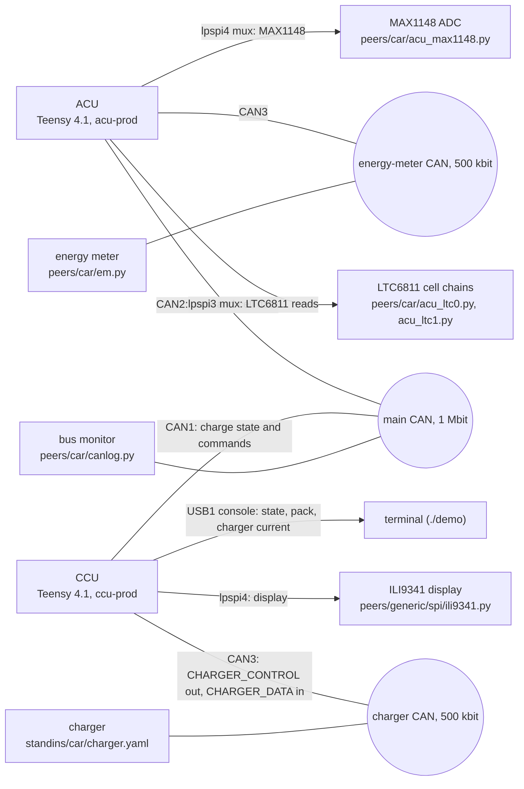
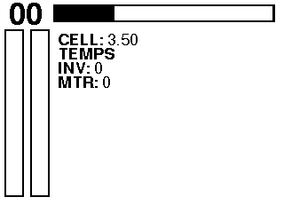
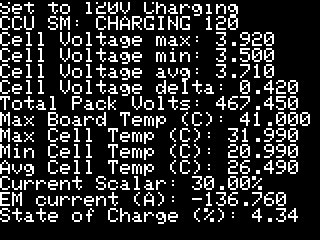
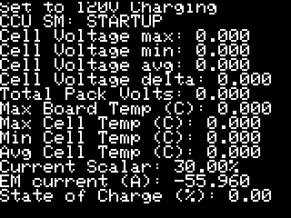
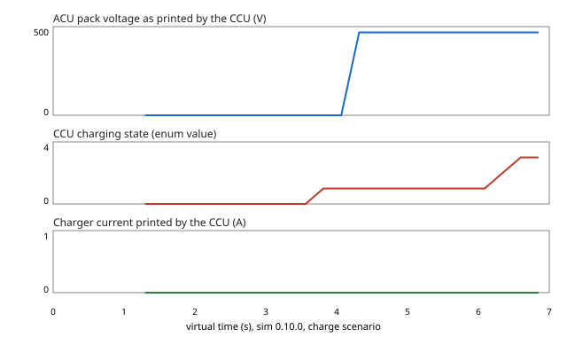
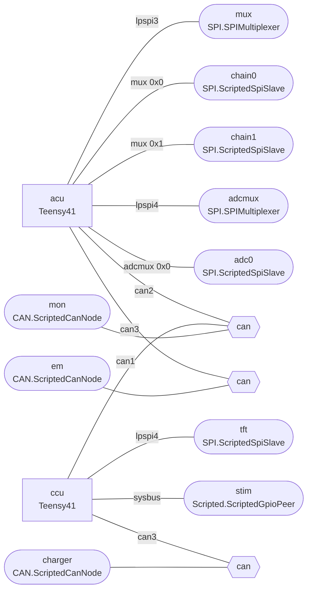

## Demo: the charging car in simulation

```sh
./demo          # after ./demo build (PlatformIO, once); about 6 minutes of wall clock on a laptop
```




The ACU and CCU firmware images are HyTech Racing's production code, built with the fork's sim-only patches and run on
simulated Teensy 4.1s over CAN. The LTC6811 pack, the energy meter and the charger are Python stand-ins: they send and
answer CAN frames at transaction level, with invented behaviour and no electrical model. The demo decodes the CCU's own
USB console (charging state from its enum, pack voltage, charger output current, its computed command) and the charger
stand-in's log of the `CHARGER_CONTROL` it received, as the run goes. Known gaps: the run is 7 s of virtual time and takes
several minutes of wall clock on a laptop (about 6 min under load here); the charger's output current is still 0.0 A at
7 s because the stand-in ramps with a 500 ms lag after the 6.85 s command; the VCF and VCR do not boot on `sim` 0.10.0
and are not in this demo; the 240 V path is not exercised. Prerequisites: `sim` 0.10.0 (`curl -fsSL https://simantic.com/install | sh`)
and PlatformIO for `./demo build`.

## This fork: the car in a simulator

Simantic's fork of HyTech Racing's firmware monorepo, with a `sim/` directory that runs the real firmware in the Simantic simulator.
**Licence:** the upstream repository carries no LICENSE file (GitHub reports none), so nothing here is a licence grant. Only `sim/`
and this section are added; nothing is offered to or published at upstream. Based on upstream `develop` at a84cb75 (`main` has moved
on; the sim-only patches apply to that commit, not to current `main`). Details: [sim/README.md](sim/README.md).

**What runs** (`sim` 0.10.0 build f219eb31, 2026-11-15, guest time bounded, all on the unmodified production envs plus 5 sim patches):

| Board | MCU | Result |
| --- | --- | --- |
| ACU | Teensy 4.1 (i.MX RT1062) | boots; reads its LTC6811 chain stand-ins; drives CAN2/CAN3 |
| CCU | Teensy 4.1 | boots; ILI9341 on LPSPI4; reaches charging, `CHARGER_CONTROL` 530 V / 0.2 A seen by the charger stand-in at 6.849 s |
| Dashboard | STM32H750 | runs 3 s without a fault in the car scenario; screen inspected, see below |
| VCF, VCR | Teensy 4.1 | **do not boot on this sim**: BusFault, see gaps |

**Screenshots from this run** (`sim` 0.10.0 build f219eb31, 2026-11-15; images in `sim/screenshots/`):

| Image | What it shows |
| --- | --- |
|  | Dashboard (STM32H750, 320x240 Sharp memory LCD) at 2.9 s of the 3 s `car` run: gear/mode "00", cell value 3.50, INV 0, MTR 0, accelerator bar empty, battery bar about a quarter filled. Matches the ACU's 3.50 V minimum cell; the inverter values are 0 because VCF/VCR did not boot (see gaps). |
|  | CCU (ILI9341) at 7 s of the `charge` run: "CCU SM: CHARGING 120", cell max 3.920 / min 3.500 / avg 3.710 V, pack 467.450 V, board temp max 41.0 C, current scalar 30 %, state of charge 4.34 %. |
|  | CCU at 3 s of the `car` run, for comparison (busy main bus). |

Signals from the `charge` run, as printed on the CCU's USB console: pack voltage reads 0 V until 4.3 s, then 467.45 V; the CCU's state goes 0 to 1 at 3.8 s, 2 at 6.34 s, 3 (charging) at 6.6 s, with the calculated charge current 0.28 A at 6.6 s and 0.29 A at 6.85 s.



**Scenario** (`sim graph --scenario sim/scenarios/car/charge.yaml`, ADC pads omitted). The whole-car graph (`car.yaml`) adds VCF, VCR and the Dashboard:



**Configurations tried:**

| Configuration | Where | Virtual | Wall | Result |
| --- | --- | --- | --- | --- |
| ACU + CCU + energy meter + charger | `charge` | 7 s | 100 s | runs; ACU 58.8 MIPS, CCU 38.8 MIPS; charger sees 530 V / 0.2 A at 6.849 s |
| Whole car, 5 boards | `car` | 3 s | 58 s | ACU, CCU, Dashboard run; VCF and VCR end in BusFault; 2110 lines on the main bus log |
| VCR alone (ready-to-drive plan) | `vcr-rtd` | 2 s | 11 s | VCR ends in BusFault at boot, no USB output |

The original author's 11 s whole-car drive cycle (600 s wall) was not re-run here: `unverified`.

**Gaps, with the evidence:**
- VCF and VCR: `FAIL: machine 'vcf' ended in BusFault at pc=0x0001382e (tempmonGetTemp)`, same for `vcr` at 0x0001680e, faulting pc in `analog_init` (Teensy core temperature-monitor read). Reproduced on the VCR alone. A model gap in the released `sim` (the i.MX RT1062 TEMPMON block is in the engine source but not in this release, `unverified` whether newer builds boot); not worked around.
- ACU and CCU: `[bus] unhandled write: 0x400c4044`, once per run, no visible effect.
- Dashboard needs `rcc: hseFrequency: 25000000` in its board file, otherwise FDCAN drops every 1 Mbit frame.
- The CCU stand-in display reports `missing_end_trailer` diagnostics from the display peer.

**Run it** (needs `sim`, PlatformIO, rsync, Python 3):

```sh
export SIM=$(which sim)
sim/build.sh
sim/run.sh charge charge-1 7
sim/run.sh car car-1 3
```

**Changes to the firmware** (applied to a copy by `sim/build.sh`, listed in `sim/patches/`): 0001 CCU display on hardware SPI; 0002 CCU debug print enabled;
0003 Dashboard init call and typo (real bug); 0004 VCF `Wire2.begin()` (real bug); 0005 sim-only fixed EEPROM calibration for VCF.

Everything below is HyTech Racing's README.

---

# HyTech Racing Monorepo

This repository contains the firmware for all HyTech Racing boards in a single, centralized codebase. Each board maintains its own directory and build configuration, preserving the separation of individual projects while enabling shared libraries, consistent tooling, and streamlined development.

## Boards

| Board | Description |
| ------ | ----------- |
| **ACU** | Accumulator Control Unit |
| **CCU** | Charger Control Unit |
| **Dashboard** | Driver Dashboard |
| **VCF** | Vehicle Controller Front |
| **VCR** | Vehicle Controller Rear |
| **RDC** | Driverless Controller |

## Documentation

For more information about the monorepo, including:

- Why we transitioned to a monorepo
- Repository organization and coding conventions
- Firmware flashing procedures
- CI/CD workflows
- And much more!

see the HyTech Racing Wiki:

<https://wiki.hytechracing.org/books/ht11-design/page/monorepo-documentation>