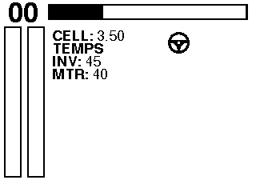
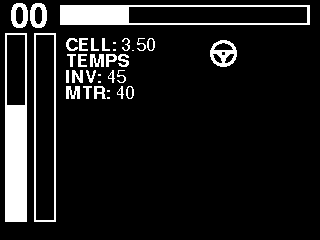
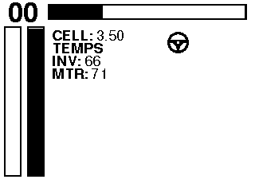
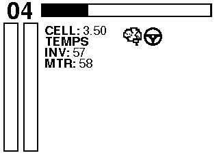
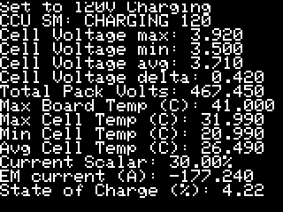
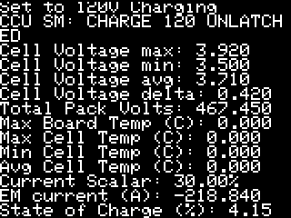

# Simantic: the whole car in a simulator

This directory runs HyTech Racing's vehicle firmware (five boards, the unmodified production ELFs plus a handful of
small sim-only patches) on Simantic's `sim` binary: no hardware, no vehicle. It sits on top of upstream `develop`
(a84cb75) and touches nothing outside `simantic/`. Bug fixes found along the way are on the separate
`simantic/fixes` branch.

## What is simulated

| Board | MCU | Firmware env | What the sim provides around it |
|---|---|---|---|
| VCF (front controller) | Teensy 4.1 | `vcf-prod` | 2x MCP3208 (pedals, brake, steering analog, load cells), MCP23017 on LPI2C4 (rotary dial), Orbis-style absolute steering encoder on LPUART4, start and MC-cycle buttons, Ethernet PHY |
| VCR (rear controller) | Teensy 4.1 | `vcr-prod` | 2x MCP3208, MCP23017 on LPI2C1, four inverters on CAN3, Drivebrain/planner node on CAN1, Ethernet PHY |
| ACU (accumulator) | Teensy 4.1 | `acu-prod` | LTC6811 chain (2 SPI chains x 6 ICs = 126 cells), MAX1148, ADC pads, energy meter on CAN3, Ethernet PHY |
| CCU (charger) | Teensy 4.1 | `ccu-prod` | ILI9341 display on LPSPI4, charger on CAN3, ADC pads and input pins, Ethernet PHY |
| Dashboard | STM32H750VB | `dash-dfu-prod` | Sharp memory LCD on SPI2, FDCAN1 on the main bus (needs `rcc: hseFrequency: 25000000`, see limits) |

Buses (instance and bit rate read from the firmware, see `scenarios/car/car.yaml`):

| Bus | Members | Rate |
|---|---|---|
| main / telemetry CAN | VCF CAN1, VCR CAN1, ACU CAN2, CCU CAN1, Dash FDCAN1, planner node, bus monitor | 1 Mbit |
| VCF front aux CAN | VCF CAN2 + empty node | 500 kbit |
| inverter CAN | VCR CAN3 + 4-inverter stand-in | 500 kbit |
| energy meter CAN | ACU CAN3 + meter stand-in | 500 kbit |
| charger CAN | CCU CAN3 + charger stand-in | 500 kbit |
| VCR rear aux CAN | not wired: the firmware never starts it | |
| Ethernet | VCF, VCR, ACU, CCU + a scripted host at 192.168.3.30 (ARP + UDP recorder), pcap | |
| UART | VCF LPUART4 <-> steering encoder, 115200 | |

### Stand-ins (everything that is not firmware)

Generic peers live in [simantic-dev/sim-fixtures](https://github.com/simantic-dev/sim-fixtures) and are referenced, not copied:
`peers/can/table_node.py` (a CAN device described by YAML), `peers/uart/abs_encoder.py`, `peers/gpio/pin_script.py`,
`peers/spi/{mcp3208,max1148,ltc6811,ili9341,sharp_memlcd}.py`, `peers/i2c/mcp23017.py`.

This directory only holds their configuration:

* `standins/car/inv4.yaml` (generated by `tools/gen_inv_yaml.py`): four inverters, STATUS/TEMPS/DYNAMICS every 10 ms,
  CONTROL_WORD/CONTROL_INPUT received, torque echo through a 20 ms lag, temperatures follow the echo, an error on FL at 8.6 s
  cleared by `remove_error`. `charger.yaml`, `em.yaml` (energy meter, 250 Hz) and `db.yaml` (planner: 0xF2 speed, 0xF1 torque limit, 100 Hz)
  are the other `table_node` configs. Their behaviour is invented; only the message layouts come from the vehicle CAN library.
* `peers/car/*.py`: thin wrappers that point a generic peer at its config or stimulus (steering profile in `enc.py`,
  pedal/brake/steering ramps in `vcf_adc0.py`, dial in `dial.py`, cell voltages in `acu_ltc*.py`, ...).
* Custom peers that are not in sim-fixtures: `peers/car/canlog.py` (bus monitor, one line per frame), `canreplay.py`
  (replays a recorded bus log, used for the Dash screens), `drivebrain_eth.py` (host at 192.168.3.30: answers ARP, records UDP).
* Pin and analog stimulus is in the `.board` files (`pin_script` configs for the buttons and CCU inputs, `ADCChannelSource` defaults).
* `scenarios/solo/` holds the single-board scenarios (below) with their own stimulus in `peers/solo/` and `standins/solo/`.

## Run it

Needs: the pyrite `sim` binary, a sim-fixtures checkout, PlatformIO, `rsync`, Python 3.

```sh
git clone https://github.com/simantic-dev/sim-fixtures      # generic peers
export SIM=/path/to/sim SIM_FIXTURES=$PWD/sim-fixtures
simantic/build.sh                  # patches a copy of the tree, builds 5 envs, writes simantic/build/elf/*.elf
simantic/run.sh car car-1 11       # whole car, 11 virtual seconds -> simantic/build/out/car-1/
simantic/run.sh charge charge-1 9  # ACU + CCU + meter + charger
simantic/run.sh vcr-rtd rtd 4      # single boards: vcf-enc vcf-i2c vcr-rtd acu ccu dash
```

`build.sh` copies the repo to `simantic/build/src`, applies `patches/`, and runs `pio run -e vcf-prod / vcr-prod / acu-prod /
ccu-prod / dash-dfu-prod`. `PATCHES=0 simantic/build.sh` builds the stock firmware. ELFs are never committed.
`run.sh` expands the `@SIMANTIC@` / `@SIM_FIXTURES@` / `@OUT@` placeholders in the scenario, board and peer files into
`simantic/build/work`, so the checked-in files hold no absolute paths. Outputs per run: `uart.txt` (USB console of every board),
`can-main.log` (bus monitor), `dash.png`, `ccu.png`, `udp.jsonl`, `eth.pcap`, `stderr.txt` (stand-in logs and the per-machine CPU table).

The sim used for the numbers below is pyrite `main` d0806d2c plus PR #2157 (CAN bus arbitration: all eight periodic inverter frames get
plain 10 ms periods and frames on one bus are serialised; without it bursts of frames overrun the Dash's 1-element FDCAN FIFO).
Every scenario sets `quantum: 0.0001`. Fixtures used: sim-fixtures `main` at 705b9fa4.
The checked-in scenarios were re-run from this directory with `build.sh` / `run.sh`: the `charge` run's CCU framebuffer is bit-identical to the original, and the `car` run reproduces the timeline below (bus log 45725 frames against 45724).

Decoding helpers (`tools/`): `build_decoder.sh` + `gen_htcan.py` build a CAN decoder from the firmware's generated `ht_can.h`;
`declog.py` prints a bus log decoded; `decframes.py` does the same for `--frames` output; `usbtext.py` / `vcrtl.py` turn the USB console
dump into text / a one-row-per-step VCR table; `pbdec.py` decodes nanopb wire data from a generated `.pb.h`; `fb2png.py` converts the
ILI9341 framebuffer; `replay.sh` replays a car run's bus log into the Dash alone to get its screen at chosen times.

## Drive cycle (`car`, 11 virtual seconds)

Stimulus: HV from 1.0 s; brake 2.0 to 3.5 s; start button 2.3 to 2.7 s; accelerator 0 to 100 % from 4.0 to 5.5 s, back to 0 at 6.6 s;
steering 180 -> 150 deg (4.6 s) -> 210 deg (7.0 s) -> 180 deg (8.2 s); dial 4 from 6.8 to 8.4 s; planner 3000 rpm / 15 Nm at 7.3 s,
5000 rpm / 8 Nm at 7.7 s, 0 at 8.2 s; inverter FL error at 8.6 s; MC-cycle button 9.3 to 9.6 s; ACU cell 1 sags from 3.5 V to 2.9 V from 8.0 s.

| Check | Result | Evidence |
|---|---|---|
| Boot, heartbeats | pass | VCR prints from 0.415 s with pedals and steering heartbeats good; encoder reply 0.413 s; STEERING_DATA and PEDALS_SYSTEM_DATA on the bus from 0.50 s |
| ACU reads its cells | pass | first non-zero BMS_VOLTAGES 0.516 s: avg 3.7099, min 3.5000, max 3.9199, pack 467.45 V (126 cells) |
| Dash shows pack and cell values | pass | cell value, temperatures and battery bar on screen at 1.5 s |
| CCU shows ACU data on the full bus | partial | ACU data reaches the CCU about once on the 4300 frames/s bus (its 16-deep RX ring; see Known limits); fine in the `charge` run |
| Tractive system active | pass | inverters report 400 V at 1.0 s; VCR NOT_ACTIVE -> ACTIVE 1.0026 s; drivetrain NO_HV -> INVERTERS_READY |
| Brake + start -> ready to drive | pass | WANTING_RTD 2.317 s, HV_ENABLED 3.004 s (the firmware's 2 s precharge wait), READY_TO_DRIVE 3.063 s |
| Buzzer | pass | frame 0x7F1 at 3.0635 s, VCF buzzer pin high 3.1155 s, low 5.1155 s (2.000 s) |
| Pedal ramp -> torque | pass | torque limits on the inverter bus follow (accel - brake) x 21 Nm x 0.7 front / 1.3 rear; 1.00 -> FL 14.70 / RL 27.30 Nm |
| Inverter echo | pass | INV1_DYNAMICS torque equals the limit through the 20 ms lag |
| Steering sweep via the encoder | pass | digital_raw 8192 -> 6945 -> 9533 -> 8192, analog_raw 2048 -> 2329 -> 1746 -> 2048, no implausibility flags |
| Dash follows | pass | brake inverts the screen, accel bar fills, INV/MTR temperatures follow the torque echo |
| Drivebrain mode 4 | pass | dial 4 at 6.917 s -> controller mode 4, planner 3000 rpm / 15 Nm becomes all four CONTROL_INPUT, 5000 rpm / 8 Nm at 7.7 s, 0 at 8.2 s; Dash shows "04" and the brain icon |
| Inverter error | pass | FL error 8.600 s -> VCR ERROR, RTD -> ACTIVE, control word drops enable, set points 0; MC-cycle button clears it (remove_error 9.319 s), no automatic RTD |
| BMS fault -> Dash | pass | cell < 3.05 V at about 8.45 s; ACU_OK bms_ok=0 from 9.5645 s; Dash shows "GET OUT!" |
| Charging (`charge`, 9 s) | pass | CCU STARTUP -> CHECK_SWITCH (4.3 s) -> CHARGING_120 (6.3 s); CHARGER_CONTROL 530 V, 0.2 A at 6.844 s, 0.3 A at 7.35 s; charger answers 1 A then 3 A; CCU screen below |

The Dash firmware parses inverter status but draws no inverter error, so the inverter fault is visible on the bus and the VCR but not on the Dash.

### Screens

Dash (320x240 Sharp memory LCD) at 1.5 s, 3.6 s (brake held), 5.5 s (accelerator bar full, temperatures rising), 7.6 s (Drivebrain mode "04"), 9.9 s (BMS fault):

  
 

CCU (ILI9341) while charging at 120 V, and at the end of the drive run (state machine at CHARGE 120 UNLATCHED, stale ACU numbers):

 

The Dash screens at the listed times were produced by replaying the recorded main-bus log into the Dash alone (`tools/replay.sh`);
the replay's final framebuffer is bit-identical to the full run's.

## Speed

Release `sim`, 100 us quantum, no `--frames`, idle machine, no live view (the per-machine table prints at the end).

| Run | virtual s | wall s | wall per virtual s | peak RSS |
|---|---|---|---|---|
| `car` (5 machines, 5 CAN buses, Ethernet, UART) | 11.0 | 599.8 | 54.5 | 740 MiB |
| `car`, first 3 s | 3.0 | 133.6 | 44.5 | 522 MiB |
| `charge` (ACU + CCU + 3 CAN) | 9.0 | 195.9 | 21.8 | 195 MiB |

Cost is spread evenly: ACU, VCR and CCU about a quarter each, Dash 15 %, VCF 12 % (33 to 61 MIPS per machine). Single boards run at roughly 2 to 11 CPU s per
virtual second. Python peers are charged to the machine that owns them, and the 4300 frames/s main bus costs every Teensy 4300 CAN interrupts/s.

## Known limits

* No vehicle dynamics: the car never moves. Inverter speed echo is 0.
* The 240 V charging branch is not exercised (it needs a control-pilot PWM stimulus); only the 120 V path ran.
* The stand-ins (inverters, charger, meter, planner) have invented behaviour; only their CAN layouts come from the firmware.
* VCF aux CAN has nothing on it, VCR rear aux CAN is not started by the firmware. Dash and VCR UDP payloads were counted, not decoded.
* The Teensy emulated EEPROM cannot be preloaded, so `patches/0005` returns a fixed calibration for erased words (sim only).
  A fresh car also has no calibration until the dash-button procedure is run.
* A board without `rcc: hseFrequency` silently uses 8 MHz; the H7 FDCAN then computes 320 kbit and drops every 1 Mbit frame with
  `reason=bit_rate_mismatch` (visible only with `--frames`). `dash.board` sets 25 MHz; this also changes the Dash frame rate.
* `--frames` records every SPI/I2C transaction too, so it cannot be used on a car scenario with a display peer (millions of lines).
* `ScriptedCanNode` has no `ctx.now_us`; the bus monitor counts its own 0.5 ms ticks, so frame times are 0.5 ms resolution.
* `--trace-symbol` applies to every machine whose ELF has the symbol (VCR and Dash both define `VCFInterface::receive_pedals_message`); mangled names are required.
* `[bus] unhandled read/write 0x400c4044/0x400c4048` is printed once per run by one Teensy; no effect on behaviour.
* Multi-machine runs have no `--progress`; `sim check` passes with 4 SysTick warnings.
* The CCU's 16-deep RX ring drops frames when the main bus is at about 4300 frames/s (15.6 % lost on the stock firmware, only during the 33 ms display redraw);
  at the 260 to 900 frames/s of a real charging session it loses none. The "ACU data reaches the CCU about once" result above used the hardware-SPI display patch, which blocks much longer.

## Firmware patches (`patches/`, applied to a copy by `build.sh`)

| Patch | Why |
|---|---|
| `0001-ccu-hardware-spi-display.patch` | CCU builds the ILI9341 on hardware SPI (`&SPI, dc, cs, rst`) instead of software SPI so the display peer on LPSPI4 sees it |
| `0002-ccu-enable-debug-print.patch` | CCU `debug_print_task` is commented out upstream; enabling it puts state and charger current on the USB console |
| `0003-dash-init.patch` | Dash: `initalize_all_interfaces` typo and the missing call in `setup()`; without it the Dash HardFaults at 21 ms (fixed upstream on `feat/DASHBOARD/UI`) |
| `0004-vcf-wire2-begin.patch` | VCF: `Wire2.begin()` before the MCP23017 is configured, otherwise the dial decodes wrong |
| `0005-vcf-sim-eeprom-calibration.patch` | sim only: fixed calibration for an erased EEPROM (the stimulus peers are written to match) |

Patches 0003 and 0004 are real bug fixes; `simantic/fixes` carries them (and others) as separate, minimal commits against the unpatched tree.
